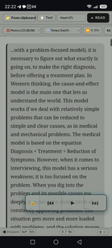

# SileroRead • Hybrid Local TTS Reader & Pimsleur Engine

A lightweight, self-hosted Web TTS audiobook reader and language trainer optimized for
low-spec desktop environments and Android (Termux / PRoot Ubuntu).

The project blends multiple local and cloud speech engines:
- **Kokoro ONNX (FP16)** — high-fidelity local English TTS (24 kHz).
- **Silero TTS (PyTorch)** — fast local Russian (`v5_ru`) and fallback English (`v3_en`).
- **Piper TTS & Edge TTS** — optional offline/online synthesis pipelines.

---

## ⚡ What Makes This Setup Unique?

1. **Local Hybrid Routing** — English synthesis goes to Kokoro ONNX by default
   (via `kokoro-onnx`) for natural speech, while Silero PyTorch handles Russian.
2. **Low-Memory Management** — explicit `gc.collect()` and Linux `malloc_trim` calls
   prevent RSS memory bloat during prolonged reading sessions.
3. **Smart Prefetching** — sentence/clause boundary chunking with sliding-window
   pre-caching (continues during UI pause states).
4. **Cross-Platform Storage Hook** — automatically targets `/sdcard/Music/` when run
   inside Android PRoot, writing files directly to accessible media dirs without
   manual transfers.

---

## 🛠️ Prerequisites & Multi-Python Environment

Kokoro ONNX and older Silero models require compatibility across ONNX Runtime,
PyTorch and tokenizers. The recommended setup uses an isolated environment on
**Python 3.10 or 3.11**.

### Installing a Specific Python Version

**Linux / Ubuntu / PRoot:**
```bash
sudo apt update
sudo apt install -y software-properties-common
sudo add-apt-repository -y ppa:deadsnakes/ppa
sudo apt update
sudo apt install -y python3.11 python3.11-venv python3.11-dev
```

**Windows:** download the official **Python 3.11.x 64-bit installer**, tick
**"Add python.exe to PATH"**, or:
```cmd
winget install Python.Python.3.11
```

---

## 🚀 Installation & Environment Setup

> ⚠️ **Important:** the full stack requires **PyTorch (CPU)** + **all four models**.
> The old install guide skipped `torch`/`torchaudio` and the Silero `.pt` models,
> which made Silero TTS non-functional. Follow the blocks below.

### 1. Clone & initialize venv

**Linux / Termux PRoot:**
```bash
git clone https://github.com/quakebass-bit/SileroRead.git
cd SileroRead

python3.11 -m venv venv
source venv/bin/activate
```

**Windows (CMD / PowerShell):**
```cmd
git clone https://github.com/quakebass-bit/SileroRead.git
cd SileroRead

py -3.11 -m venv venv
venv\Scripts\activate
```

---

### 2. Install system deps + Python packages + download ALL models

#### 🐧 Linux / Ubuntu / Termux PRoot
```bash
# 1. System deps (audio headers, ffmpeg, downloaders)
sudo apt update && sudo apt install -y libsndfile1 ffmpeg curl wget

# 2. PyTorch (CPU) + Python deps
pip install torch torchaudio --index-url https://download.pytorch.org/whl/cpu
pip install flask ru-normalizr num2words kokoro-onnx soundfile onnxruntime \
            scipy pydub imageio-ffmpeg edge-tts

# 3. Download ALL models (Silero RU/EN + Kokoro EN) into models/
mkdir -p models
curl -L https://models.silero.ai/models/tts/ru/v5_ru.pt -o models/v5_ru.pt
curl -L https://models.silero.ai/models/tts/en/v3_en.pt -o models/v3_en.pt
curl -L https://github.com/thewh1teagle/kokoro-onnx/releases/download/model-files-v1.0/kokoro-v1.0.fp16.onnx -o models/kokoro-v1.0.fp16.onnx
curl -L https://github.com/thewh1teagle/kokoro-onnx/releases/download/model-files-v1.0/voices-v1.0.bin -o models/voices-v1.0.bin
```

#### 🪟 Windows (PowerShell)
```powershell
# 1. PyTorch (CPU) + Python deps
pip install torch torchaudio --index-url https://download.pytorch.org/whl/cpu
pip install flask ru-normalizr num2words kokoro-onnx soundfile onnxruntime scipy pydub imageio-ffmpeg edge-tts

# 2. Create models folder and download ALL models
New-Item -ItemType Directory -Force -Path models | Out-Null
curl.exe -L https://models.silero.ai/models/tts/ru/v5_ru.pt -o models\v5_ru.pt
curl.exe -L https://models.silero.ai/models/tts/en/v3_en.pt -o models\v3_en.pt
curl.exe -L https://github.com/thewh1teagle/kokoro-onnx/releases/download/model-files-v1.0/kokoro-v1.0.fp16.onnx -o models\kokoro-v1.0.fp16.onnx
curl.exe -L https://github.com/thewh1teagle/kokoro-onnx/releases/download/model-files-v1.0/voices-v1.0.bin -o models\voices-v1.0.bin
```

**Windows CMD users:** replace the `New-Item ...` line with `mkdir models 2>nul`.
Everything else works the same via `curl.exe`.

### Final `models/` layout
```
models/
├── v5_ru.pt                  # Silero RU
├── v3_en.pt                  # Silero EN (fallback)
├── kokoro-v1.0.fp16.onnx     # Kokoro
└── voices-v1.0.bin           # Kokoro voices
```
> Ensure these paths match `app.py` (`models/kokoro-v1.0.fp16.onnx`,
> `models/voices-v1.0.bin`, etc.).

---

## ⚙️ Key Troubleshooting & Resolved Issues

### 1. Kokoro ONNX / Audio Dependencies
- **Issue:** `ModuleNotFoundError: No module named 'soundfile'` or `scipy`.
- **Fix:** Kokoro ONNX needs C audio headers:
```bash
apt install -y libsndfile1 ffmpeg
pip install soundfile scipy kokoro-onnx
```

### 2. Silero "model not found" / `torch` missing
- **Issue:** Silero TTS crashes on start.
- **Fix:** make sure `torch` + `torchaudio` are installed (CPU wheel) and that
  `models/v5_ru.pt` and `models/v3_en.pt` exist. Old README did not install these.

### 3. Windows Async / WebSocket 403 (Edge TTS fallback)
- **Issue:** `403 Invalid response status` or `No audio was received` under Windows
  due to `ProactorEventLoop` socket drops.
- **Fix:** switch the event loop policy on NT:
```python
import platform, asyncio
if platform.system() == 'Windows':
    asyncio.set_event_loop_policy(asyncio.WindowsSelectorEventLoopPolicy())
```
Or run CLI generation via `subprocess` to isolate execution.

### 4. CPU Core Allocation & Thermal Throttling
- **Issue:** high thread counts cause thermal throttling on mobile ARM CPUs (big.LITTLE).
- **Configuration:**
  - **PC / Laptop (AC power):** 4–6 threads (`torch.set_num_threads(4)`).
  - **Mobile (PRoot Android):** 2 threads for continuous reading, up to 4 for short
    lesson-builder generation.

### 5. Git Conflicts with Untracked Files on Mobile
- **Issue:** `error: The following untracked working tree files would be overwritten by merge`.
- **Fix:** backup and re-sync:
```bash
mv Shadowing.py Shadowing.py.bak
git pull
```

---

## 🏃 Execution

### Web Reader
```bash
# Activated venv
python app.py
# http://127.0.0.1:5008
```

### Pimsleur Generator
```bash
python pimsleur_app.py
# http://127.0.0.1:5011
```

### Shadowing Trainer
```bash
python Shadowing.py
# http://127.0.0.1:5001
```

---

## 📱 Termux / PRoot Aliases (single-command launches)

Add to `~/.bashrc` in Termux:
```bash
alias st-rd='proot-distro login ubuntu -- bash -c "cd ~/SileroRead && source venv/bin/activate && python app.py"'
alias st-pim='proot-distro login ubuntu -- bash -c "cd ~/SileroRead && source venv/bin/activate && python pimsleur_app.py"'
alias st-shadow='proot-distro login ubuntu -- bash -c "cd ~/SileroRead && source venv/bin/activate && python Shadowing.py"'
```
```
