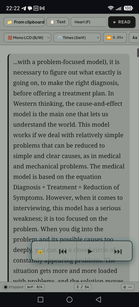

# SileroRead • Hybrid Local TTS Reader & Pimsleur Engine

A lightweight, self-hosted Web TTS audiobook reader and language trainer optimized for low-spec desktop environments and Android (Termux / PRoot Ubuntu).

The project blends multiple local and cloud speech engines:
- **Kokoro ONNX (FP16)** — High-fidelity local English TTS (24 kHz).
- **Silero TTS (PyTorch)** — Fast local Russian (`v5_ru`) and fallback English (`v3_en`).
- **Piper TTS & Edge TTS** — Optional offline/online synthesis pipelines.

---

## ⚡ What Makes This Setup Unique?

1. **Local Hybrid Routing**: Routes English synthesis to Kokoro ONNX by default (via `kokoro-onnx`) for natural speech, while keeping Silero PyTorch for Russian.
2. **Low-Memory Management**: Explicit `gc.collect()` and Linux `malloc_trim` calls prevent RSS memory bloat during prolonged reading sessions.
3. **Smart Prefetching**: Sentence/clause boundary chunking with sliding-window pre-caching (continues during UI pause states).
4. **Cross-Platform Storage Hook**: Automatically targets `/sdcard/Music/` when executed inside Android PRoot, writing files directly to accessible media directories without manual file transfers.

---

## 🛠️ Prerequisites & Multi-Python Environment

Kokoro ONNX and older Silero models require compatibility across ONNX Runtime, PyTorch, and tokenizers. The recommended setup uses an isolated environment on **Python 3.10 or 3.11**.

### Installing a Specific Python Version

#### On Linux / Ubuntu / PRoot:
```bash
sudo apt update
sudo apt install -y software-properties-common
sudo add-apt-repository -y ppa:deadsnakes/ppa
sudo apt update
sudo apt install -y python3.11 python3.11-venv python3.11-dev

```

#### On Windows:

Download the official **Python 3.11.x 64-bit installer**, check **"Add python.exe to PATH"**, or use `winget`:

```cmd
winget install Python.Python.3.11

```

---

## 🚀 Installation & Environment Setup

### 1. Clone & Initialize Venv

**Linux / Termux PRoot:**

```bash
git clone [https://github.com/quakebass-bit/SileroRead.git](https://github.com/quakebass-bit/SileroRead.git)
cd SileroRead

# Create venv with specific Python binary
python3.11 -m venv venv
source venv/bin/activate

```

**Windows (CMD/PowerShell):**

```cmd
git clone [https://github.com/quakebass-bit/SileroRead.git](https://github.com/quakebass-bit/SileroRead.git)
cd SileroRead

py -3.11 -m venv venv
venv\Scripts\activate

```

### 2. Install Core Dependencies

```bash
pip install --upgrade pip
pip install flask ru-normalizr num2words soundfile scipy pydub imageio-ffmpeg

```

### 3. Install Kokoro ONNX & Models

Kokoro ONNX requires `kokoro-onnx` and `soundfile`:

```bash
pip install kokoro-onnx soundfile onnxruntime

```

Download model weights into the `models/` folder:

* `kokoro-v1.0.fp16.onnx`
* `voices-v1.0.bin`

```bash
mkdir -p models
# Download the model and voices files into models/
# Ensure paths match app.py:
# models/kokoro-v1.0.fp16.onnx
# models/voices-v1.0.bin

```

---

## ⚙️ Key Troubleshootings & Resolved Issues

### 1. Kokoro ONNX / Audio Dependencies

* **Issue**: `ModuleNotFoundError: No module named 'soundfile'` or `scipy`.
* **Fix**: Kokoro ONNX requires C-library audio headers. In Debian/Ubuntu/PRoot:
```bash
apt install -y libsndfile1 ffmpeg
pip install soundfile scipy kokoro-onnx

```


### 2. Windows Async / WebSocket 403 Errors (Edge TTS fallback)

* **Issue**: `403 Invalid response status` or `No audio was received` under Windows due to `ProactorEventLoop` socket drops.
* **Fix**: Switch the event loop policy in Python entry points on NT:
```python
import platform, asyncio
if platform.system() == 'Windows':
    asyncio.set_event_loop_policy(asyncio.WindowsSelectorEventLoopPolicy())

```


Or run CLI generation via `subprocess` directly to isolate execution.

### 3. CPU Core Allocation & Thermal Throttling

* **Issue**: High thread counts cause thermal throttling on mobile ARM CPUs (big.LITTLE).
* **Configuration**:
* **PC / Laptop (AC Power)**: 4 to 6 threads (`torch.set_num_threads(4)`).
* **Mobile (PRoot Android)**: 2 threads for continuous reading, up to 4 for short lesson-builder generation.


### 4. Git Conflicts with Untracked Files on Mobile

* **Issue**: `error: The following untracked working tree files would be overwritten by merge`.
* **Fix**: Backup and re-sync:
```bash
mv Shadowing.py Shadowing.py.bak
git pull

```


---

## 🏃 Execution

### Web Reader

```bash
# Activated venv
python app.py
# Access at [http://127.0.0.1:5008](http://127.0.0.1:5008)

```

### Pimsleur Generator

```bash
python pimsleur_app.py
# Access at [http://127.0.0.1:5011](http://127.0.0.1:5011)

```

### Shadowing Trainer

```bash
python Shadowing.py
# Access at [http://127.0.0.1:5001](http://127.0.0.1:5001)

```

---

## 📱 Termux / PRoot Aliases Example

Add to your `~/.bashrc` in Termux for single-command launches:

```bash
alias st-rd='proot-distro login ubuntu -- bash -c "cd ~/SileroRead && source venv/bin/activate && python app.py"'
alias st-pim='proot-distro login ubuntu -- bash -c "cd ~/SileroRead && source venv/bin/activate && python pimsleur_app.py"'
alias st-shadow='proot-distro login ubuntu -- bash -c "cd ~/SileroRead && source venv/bin/activate && python Shadowing.py"'

```

